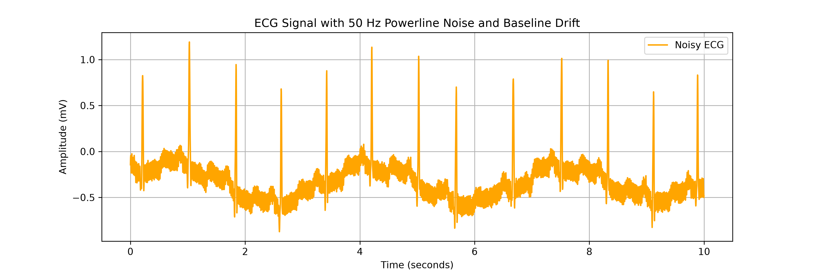
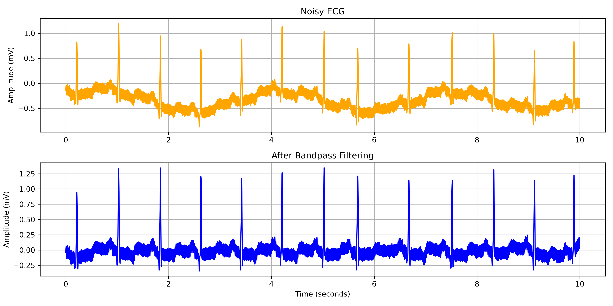
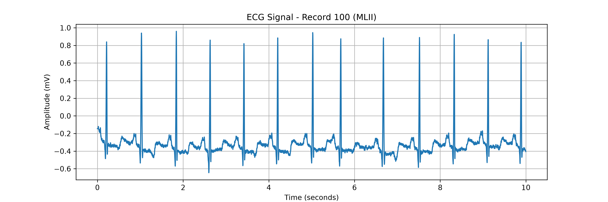
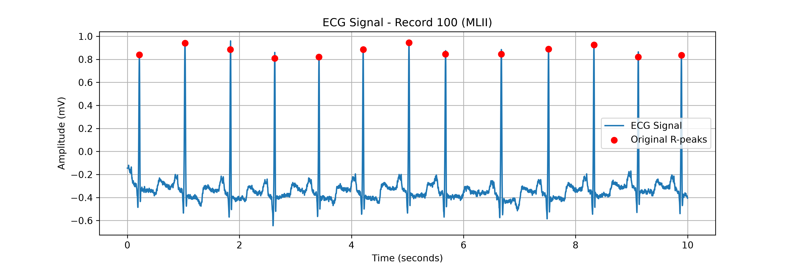
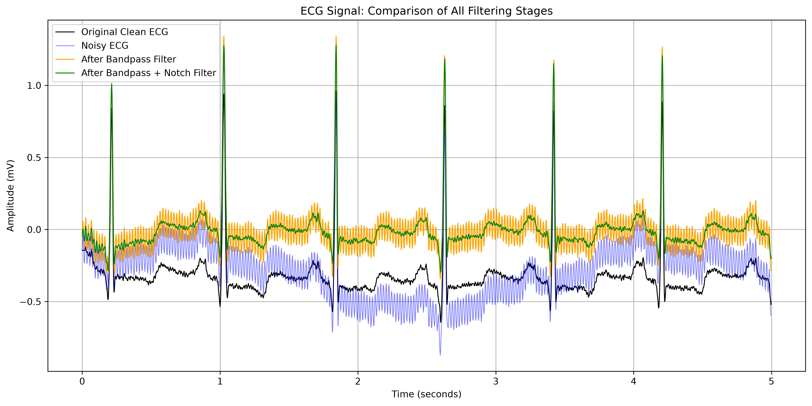
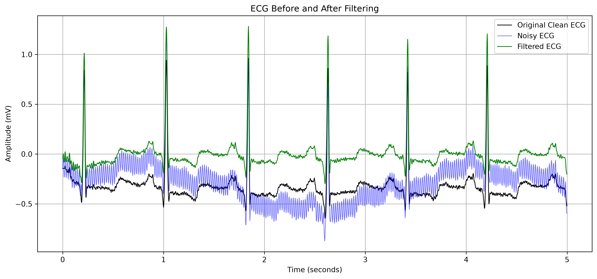
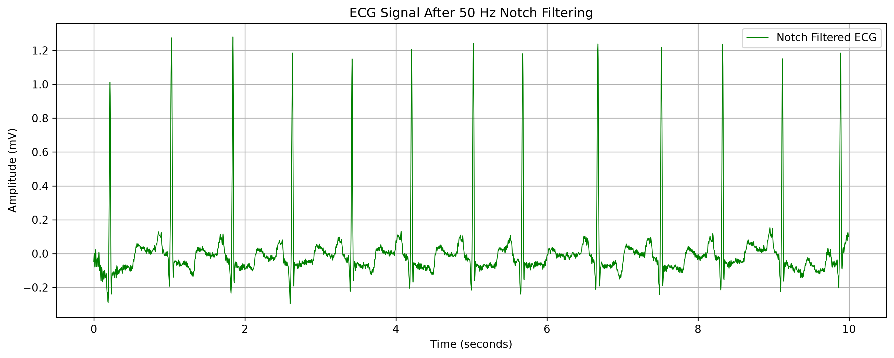

# ECG Signal Processing and Noise Filtering

## Project Overview

This project focuses on ECG (Electrocardiogram) signal processing using Python. It explores how different types of noise affect ECG signals and how digital filters can be used to reduce unwanted noise while preserving important ECG characteristics.

The project uses ECG recordings from the MIT-BIH Arrhythmia Database.

## Objectives

- Load and visualize ECG recordings.
- Understand the effect of noise on ECG signals.
- Add synthetic 50 Hz power-line interference and baseline drift.
- Design and apply digital filters.
- Compare ECG signals before and after filtering.
- Evaluate filtering performance using Signal-to-Noise Ratio (SNR).

## Tools and Technologies

- Python
- NumPy
- Matplotlib
- SciPy
- WFDB
- VS Code

## Dataset

**MIT-BIH Arrhythmia Database**

Source: [PhysioNet - MIT-BIH Arrhythmia Database](https://physionet.org/content/mitdb/1.0.0/)

ECG records included in this repository:
- Record 100
- Record 105

## Methodology

The project follows these processing stages:

1. **ECG Signal Acquisition:** Load ECG recordings using the WFDB library.
2. **Noise Addition:** Introduce synthetic 50 Hz power-line noise and baseline drift.
3. **Bandpass Filtering:** Apply a 4th-order Butterworth bandpass filter with cutoff frequencies of 0.5 Hz and 100 Hz.
4. **Notch Filtering:** Apply a 50 Hz notch filter to reduce power-line interference.
5. **Signal Comparison:** Compare noisy and filtered ECG signals.
6. **Performance Evaluation:** Calculate SNR to evaluate filtering performance.

## Results and Visualizations

### 1. ECG Signal with 50 Hz Noise



### 2. Bandpass Filtered ECG



### 3. Original ECG Recording



### 4. Annotated ECG Recording



### 5. Comparison of Filtering Stages



### 6. Before and After Filtering



### 7. Notch Filtered ECG



## Project Structure

```text
miniproject/
│
├── ecgproject/
│   └── ecganalysis.py
│
├── mitdb/
│   ├── 100.atr
│   ├── 100.dat
│   ├── 100.hea
│   ├── 105.atr
│   ├── 105.dat
│   └── 105.hea
│
├── ECG_50Hz_Noisy.png
├── ECG_Bandpass_Filtered.png
├── ECG_Record_100.png
├── ECG_Record_100_Annotated.png
├── all_filtering_stages.png
├── before_after_comparison.png
└── notch_filtered_ecg.png
```

## Installation and Execution

Install the required Python libraries:

```bash
pip install numpy matplotlib scipy wfdb
```

Run the Python script from the project root directory:

```bash
python ecgproject/ecganalysis.py
```

## Dataset Citation and Attribution

The MIT-BIH Arrhythmia Database is provided by PhysioNet.

Moody, G. B., & Mark, R. G. (2005). MIT-BIH Arrhythmia Database (version 1.0.0). PhysioNet.

[Dataset DOI: 10.13026/C2F305](https://doi.org/10.13026/C2F305)

Dataset license: [Open Data Commons Attribution License (ODC-By 1.0)](https://physionet.org/content/mitdb/view-license/1.0.0/)

## Disclaimer

This project is developed for educational and signal-processing learning purposes. It is not intended for clinical diagnosis or medical decision-making.

## Author

Sneha Gupta

GitHub: [sneha-ec](https://github.com/sneha-ec)